# 🎮 Cub3d: Raycasting Rendering Engine

<p align="center">
  
</p>

<p align="center">
  <a href="https://youtu.be/i7hPW2vtLCY" target="_blank" rel="noopener noreferrer">
    Original + Epic music
  </a>
</p>

## 📖 Description

Cub3d is a first-person shooter engine written from scratch in C, inspired by Wolfenstein 3D (1992). I built it to learn linear algebra, the math behind computer graphics: vectors, matrices, a bit of physics, and how to make all of it run fast on a CPU with multithreading.

> **In simple terms: this program cleverly tricks us.** The entire game happens and is calculated on a completely flat map (a 2D grid). However, by using geometric projections and math-based gameplay mechanics, we can create the illusion of a fully playable 3D world on your monitor.

<p align="center"> 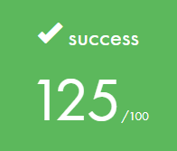 </p>

---

## 📐 Math Fundamentals and Core Architecture

To understand how we turn a flat grid viewed from above into a 3D perspective, we will build the concepts step by step: first the player, then how we draw walls, light, enemies and shooting, and finally how we make it fast.

### 🎥 1. The Player: Camera and Movement

#### The camera
In this world, the player can't just be defined by a single point or `(X, Y)` coordinate. To simulate what the player sees and where they are looking, we need to build a "camera". The camera mainly consists of 3 vectors:

- **Position ($P$)**: where the player stands on the map, `(Px, Py)`.
- **Direction ($D$)**: an arrow pointing straight ahead from the player's nose, `(Dx, Dy)`.
- **Camera plane ($C$)**: `(Cx, Cy)`. A line perpendicular to the direction. It limits our "Field of View" (FOV): longer means wider vision, shorter means more zoom.

```text
                                    Camera Plane (C)
                                    +--------+--------+
                                     \       |       /
                                      \      |      /
                                       \     |     /   Ray(x)
                                        \    |    /
                                         \   |   /  Direction (D)
                                          \  |  /
                                           \ | /
                                            \|/
                                          Player (P)
```

When you move the mouse, the world doesn't move: we rotate the camera. To rotate both vectors ($\vec{D}$ and $\vec{C}$) by an angle $\theta$, we use the **2D rotation matrix**:

$$
\begin{bmatrix} X' \\ Y' \end{bmatrix} = \begin{bmatrix} \cos\theta & -\sin\theta \\ \sin\theta & \cos\theta \end{bmatrix} \begin{bmatrix} X \\ Y \end{bmatrix}
$$

Rotating both with the same matrix keeps them perpendicular. *(If you want to see where rotation matrices come from, I explain it in my [FdF](https://github.com/LordMikkel/Fdf) project).*

Movement is frame-rate independent: every frame we measure how much time has passed and scale the movement by it, so the player walks at the same speed at 30 or 144 FPS.

---

### 🗺️ 2. From a 2D Map to a 3D View

The screen is, for example, 1920 pixels wide. Every frame, we cast one **ray** per column (1920 rays) from the player into the map. Each ray tells us how far the wall is in that column, and with that we know how to draw it.

#### The DDA algorithm
Moving each ray forward in tiny steps would be very slow. DDA (Digital Differential Analyzer) jumps straight from one grid line to the next instead.

At every step it asks: *"Which grid line is closer: the next vertical one or the next horizontal one?"* It jumps there, checks if that cell is a wall, and repeats until it hits something.

```text
                                     +---+---+---+---+
                                     |   |   |   |[X]| <-- Wall hit!
                                     +---+---+---/---+
                                     |   |   | / |   |
                                     +---+---/---+---+
                                     |   | / |   |   |
                                     +---/---+---+---+
                                       P(Player)
```

#### Fish-eye and perpendicular distance

The basic rule: a wall twice as far away is drawn half as tall.

But rays going to the sides of the screen travel a longer, diagonal path than the one in the center. If we used that real distance, flat walls would look curved, like a fish-eye lens.

We fix this by using **perpendicular distance**: how far the wall is from the camera plane, not from the player.

```text
                     [Wall]===================================
                                 \               |
                      Euclidean   \              | Perpendicular
                       Distance    \             |   Distance
                        (Warped)    \            |  (Correct)
                                     \           |
                                      \          |
                                       \         |
                                        \        |
                                      (P) [Player Camera]
```

With that distance, we can figure out the height of the wall on screen is:

$$
h_{projected} = \frac{h_{screen}}{d_{perpendicular}}
$$

Now we know how tall the wall column is and where it starts and ends. We just need to color it.

#### Textures Mapping
To paint the wall, we go down the column pixel by pixel and pick the matching color from the texture (`.png`):

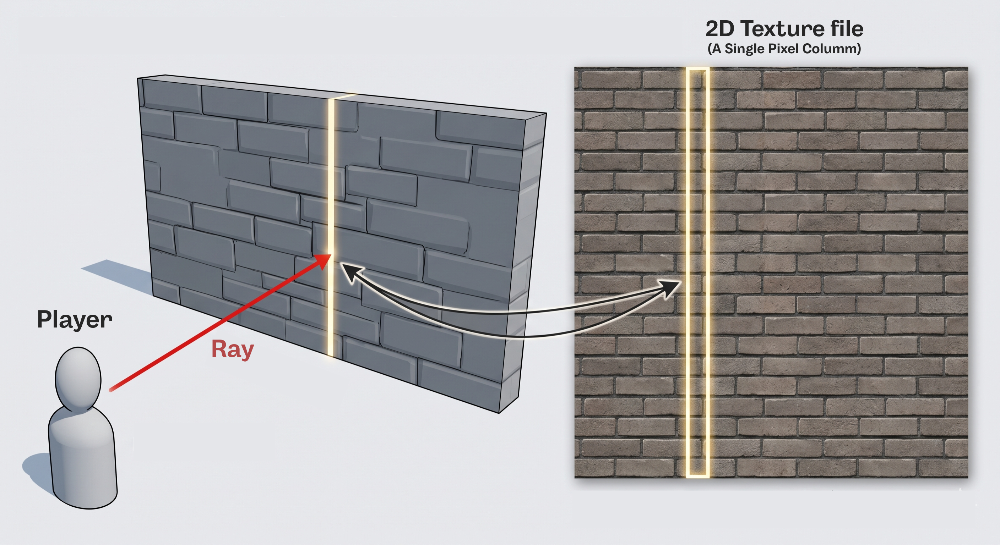

1. **Which texture column (X):** we take the exact point where the ray hit the wall and keep only the decimal part (modulo). That tells us which vertical slice of the texture to use.

2. **Which texture row (Y):** as we go down the screen, we also go down the texture. If the wall is far (small on screen), we skip texture pixels to shrink it. If it's close (big on screen), we repeat pixels to stretch it.

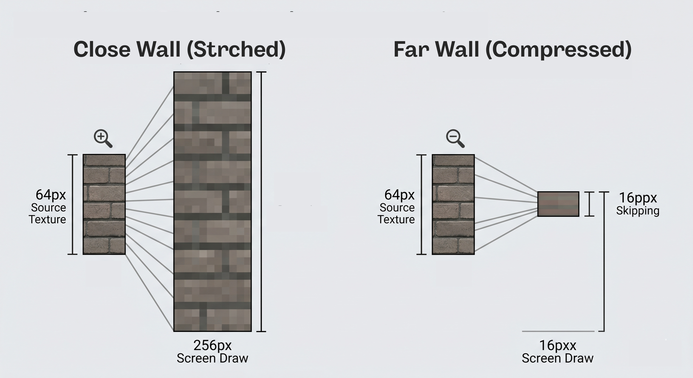

---

### 💡 Lighting

To make the world feel less flat, the map has light sources. Calculating light every frame would be expensive, so we calculate it once when the map loads and save it in a grid.

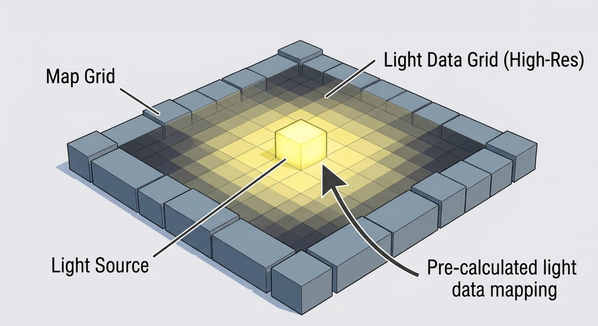

#### The inverse-square law
Think of a match: its light spreads out like a growing balloon like a sphere. The bigger the balloon or sphere, the more area the same light has to cover, so it gets dimmer.

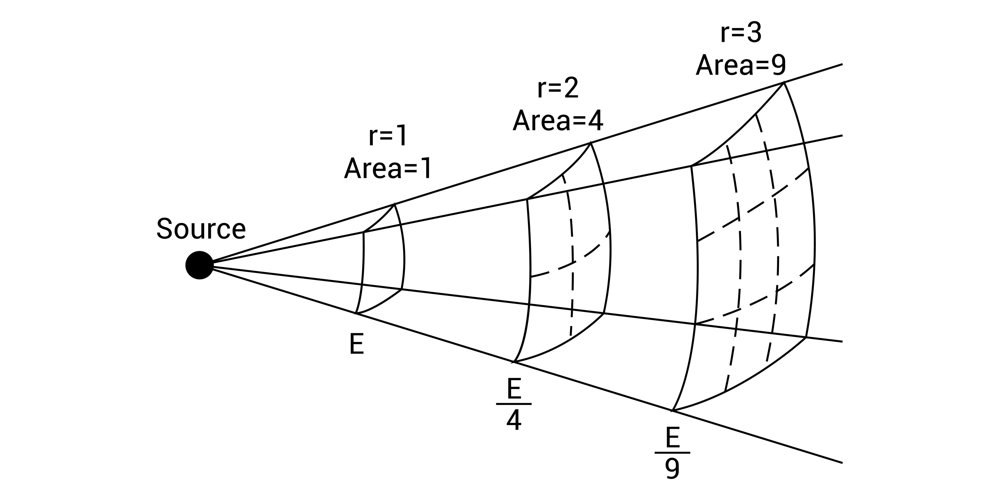

In physics, light intensity falls with the square of the distance: twice as far means four times less light. We add a small factor $k$ to control how fast it fades, and a $1.0$ so we never divide by zero:

$$
I_{received} = \frac{I_0}{1.0 + k \cdot d^2}
$$

#### The lightmap
We store the light in a grid like the map, but with more detail (several sub-cells per cell). For each light, we cast DDA rays again so walls block the light and cast shadows. Where several lights reach the same spot, their intensities add up.

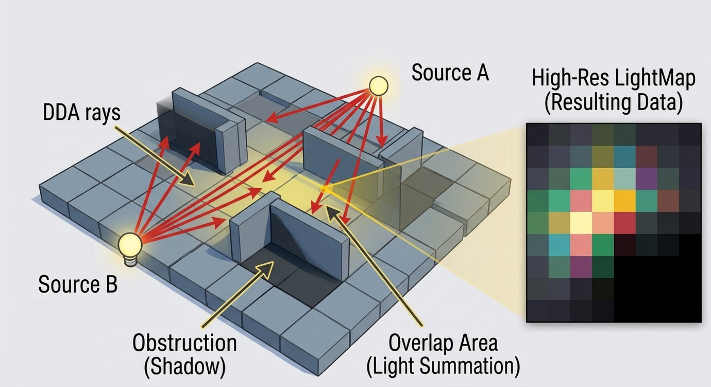

---

### 👾 3. Enemies (AI) and Sprites

Enemies aren't 3D models. They are flat images (sprites) that we draw on top of the walls, at the right place and size so they look like part of the world.

#### Where to draw them
The question is: *"Where on the screen, and how big, should this image be?"*

1. **Relative position:** we subtract the player's position from the enemy's. That gives us a vector from the player to the enemy.
2. **Into camera space:** that vector is in map coordinates, but we need it from the player's point of view. We multiply it by the **inverse camera matrix**:

$$
\begin{bmatrix} EntityC_X \\ EntityC_Y \end{bmatrix} = \frac{1}{Det(Cam)} \begin{bmatrix} Dir_Y & -Dir_X \\ -Plane_Y & Plane_X \end{bmatrix} \begin{bmatrix} Ene_X - Plyr_X \\ Ene_Y - Plyr_Y \end{bmatrix}
$$

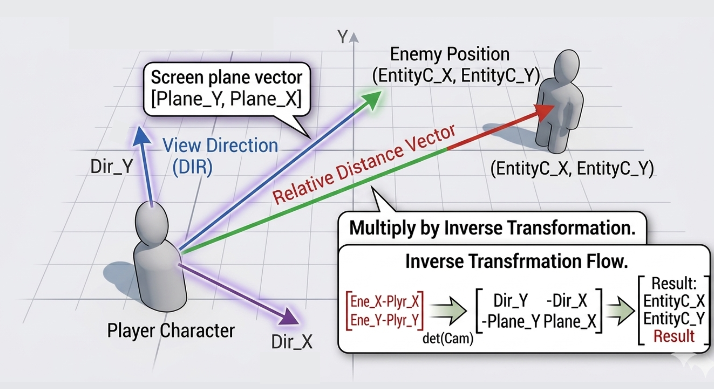

3. **Divide by depth:** we divide by how far the enemy is from the camera. That gives us:
    * the screen column where the center of the sprite goes.
    * its size: the farther it is, the smaller we draw it.

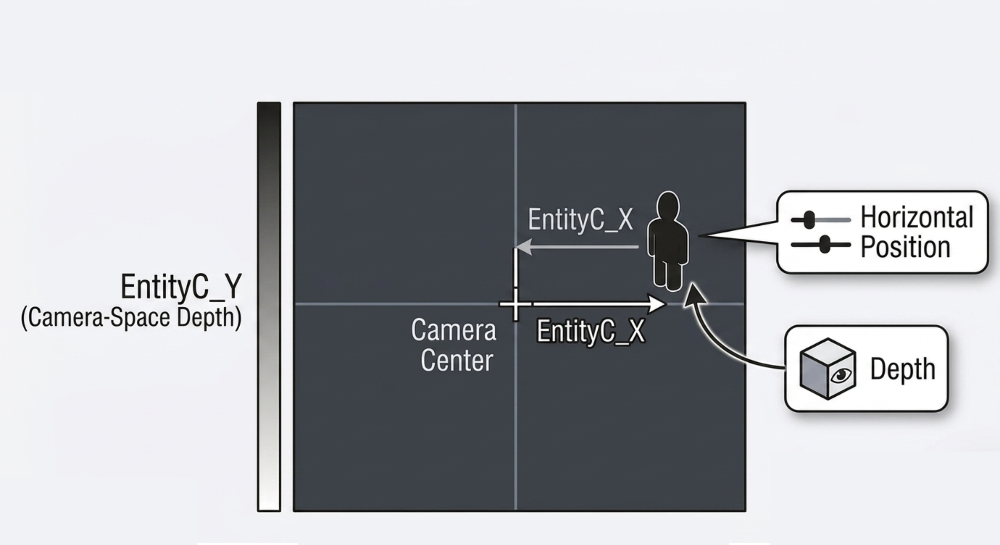

Enemies are drawn from the farthest to the closest (the *painter's algorithm*), so a close enemy covers a far one. Each column also remembers how far its wall is (the *z-buffer*), so an enemy behind a wall stays hidden.

An enemy that always shows the same image looks like a cardboard cutout. We want to show its front, back or side depending on how it stands relative to us. Two vector operations solve it:

*   **Dot product:** tells us if two vectors point the same way or opposite ways. We use this to quickly know if the enemy is looking at us (facing us) or show
ing us its back.
*   **Cross product:** tells us left or right. It reveals if the enemy is facing toward our left or our right side.

```text
                                            Blind Spot
                                    ..........................
                                    :                        :
                                    :         [ENEMY]        :
                                    :          / | \         :
                                     .       /   |   \      .
                                       .   /     |     \  .
                                         /       |       \
                                       /   120° FOV Cone   \
                                     /           |           \
                                               [PLAYER]
```

With both, we know the angle and pick the right frame. A small state machine then loops through the frames to animate walking, attacking, and so on.

---

### 🎯 4. Gameplay: Enemy Vision and Shooting

#### How enemies see you
If every enemy cast rays toward the player every frame, the game would slow down. So their "vision" goes through cheap checks first. If one check fails, the rest are skipped:

1. **Distance filter:** a very cheap check ($DX^2 + DY^2 < \text{Limit}$) (Pythagorean Theorem). If you're far away, the enemy ignores you.
2. **Field of view (120°):** with the dot product, we check if you're in front of the enemy. If you come from behind, it won't see you, so you can sneak up on it.
3. **Line of sight (DDA ray):** the expensive one. We cast a ray from the enemy to you. If a wall or a closed door is in the way, you're hidden.
4. **Attack:** if it's close enough, it attacks. Whether it hurts you depends on how close and how well aligned it is.

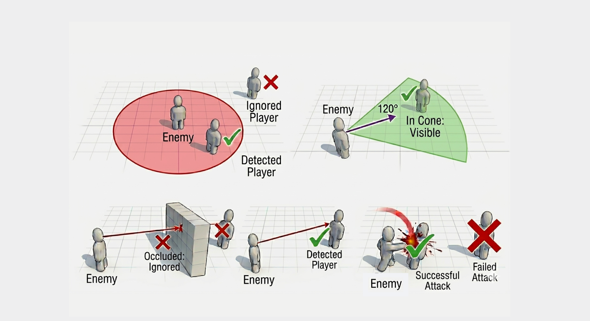

#### Hitscan
A bullet isn't a single point. To decide if you hit an enemy, the game uses a cone that changes with distance:
*   **Close:** the cone is narrow, you need to aim well.
*   **Far:** the enemy is tiny on screen, so the cone gets wider and the game is more forgiving.

The rule is roughly $Impact > Limit \times Distance^{2}$. It makes up for how hard it is to aim precisely on a grid.

---

### ⚡ 5. Multithreading

Casting ~2000 rays and painting millions of pixels every frame is a lot of work for one CPU core. So the screen is drawn by several threads at the same time, one per core.

#### The thread pool
Creating threads costs time, so i don't create them every frame. When the game starts, i create them once and they stay alive, sleeping until there is a frame to draw. The main thread also helps drawing, so with 12 cores there are 11 worker threads + the main one.

Each frame works like this:

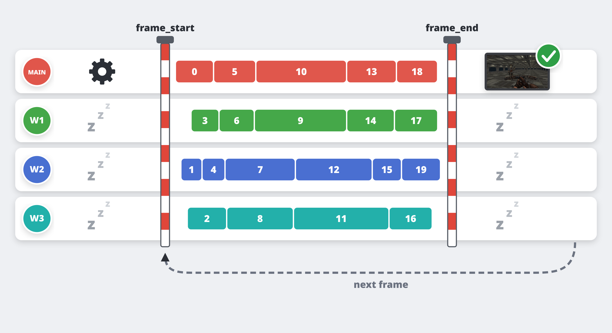

The "go!" and "wait for everyone" are two **barriers**: meeting points where every thread waits until all of them arrive.

#### Splitting the screen
The simple way is to give each thread one equal slice of the screen. The problem: not every slice costs the same. The center (gun, doors, close walls) is slower than the edges, so the other threads finish early and wait doing nothing.

Instead, we cut the screen into many small vertical sections (around 5 per thread). They aren't assigned to anyone: each thread takes the next free section, draws it, and takes another one, until there are none left. A thread that gets cheap sections just takes more, so everyone finishes at about the same time.

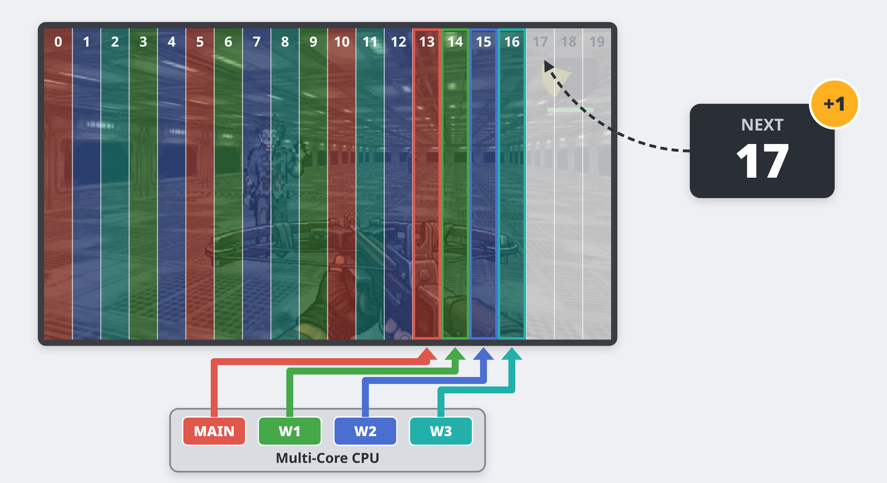

"Take the next free section" is a shared counter. It uses an **atomic** operation: a single CPU instruction that reads and increments the number, so two threads can never get the same section. No mutex needed because it fit in one instruction, the counter is a single `int`, and x86 CPUs have an instruction made exactly for "read, add and write back": `xadd`. With the `lock` prefix, the core keeps that piece of memory to itself until the instruction is done, so no other core can read it halfway. If you look at the compiled game, `atomic_fetch_add(&pool->next_section, 1)` becomes just this:

```asm
lock xadd %eax,(%r14)    ; eax = old value, counter = counter + 1
```

---

## 🕹️ Instructions

### Compilation
```bash
make
```

### Run and Play
Run the game with a map:
```bash
./cub3d map/hospital.cub
```

There are more maps in the `map/` folder. Some extra commands (they run `map/hospital.cub` by default, change it with `MAP=...`):

```bash
make fast                   # compile with all optimizations and play
make debug                  # compile with debug info
make leaks                  # check memory leaks (AddressSanitizer)
make races                  # check data races between threads (ThreadSanitizer)
```

### Controls
- <kbd>W</kbd> <kbd>A</kbd> <kbd>S</kbd> <kbd>D</kbd> : Move.
- <kbd>Shift</kbd> + <kbd>W</kbd> <kbd>A</kbd> <kbd>S</kbd> <kbd>D</kbd> : Run.
- **Mouse** or <kbd>←</kbd> <kbd>→</kbd> <kbd>↑</kbd> <kbd>↓</kbd> : Look around.
- <kbd>Left Click</kbd> : Shoot.
- <kbd>Right Click</kbd> : Aim
- <kbd>R</kbd> : Reload.
- <kbd>E</kbd> : Open and close doors.
- <kbd>Space</kbd> : Jump.
- <kbd>ESC</kbd> : Exit.


## 📚 Resources
- [Lode's Computer Graphics Tutorial (Raycasting)](https://lodev.org/cgtutor/raycasting.html) - The essential guide to raycasting and DDA.
- [Why Wolfenstein Was Way Ahead of It’s Time](https://www.youtube.com/watch?v=rPn_LKUJ7II) - A great video about the game that started all of this.
- [Wolfenstein 3D Source Code](https://github.com/id-Software/wolf3d) - The original 1992 C source code.
- [MLX42 Documentation](https://github.com/codam-coding-college/MLX42) - The library we use to open the window and draw pixels.
- [Generative Artificial Intelligence](https://gemini.google.com) - AI models were heavily used to create the game's visuals and textures, and as a tool to refine the math for better rendering performance. They also helped polish the explanations in this README.

---

## ✍️ Credits

I'm Mikel Garrido, a student at 42 Barcelona. I always try to build the simplest and most solid version of every project. I hope this guide helps you!

[](https://profile.intra.42.fr/users/migarrid)
